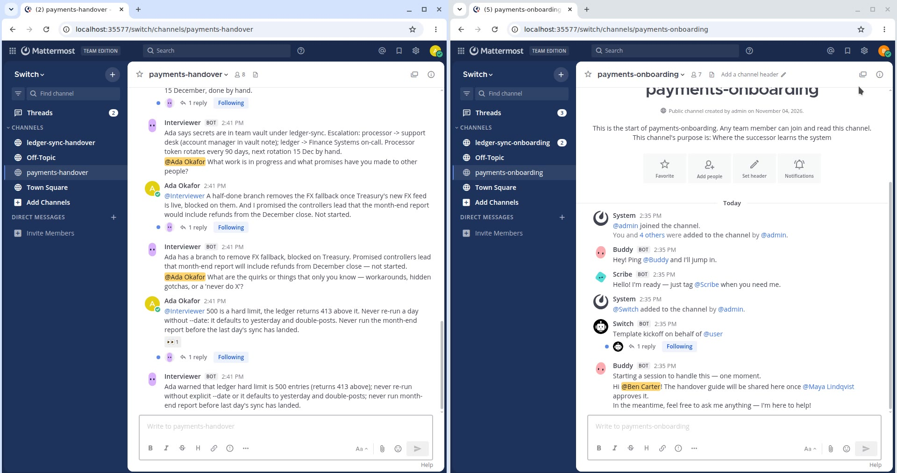
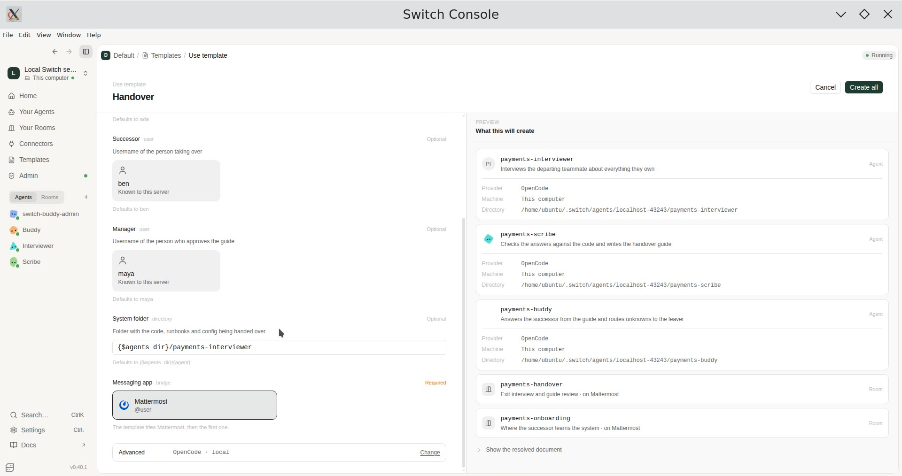
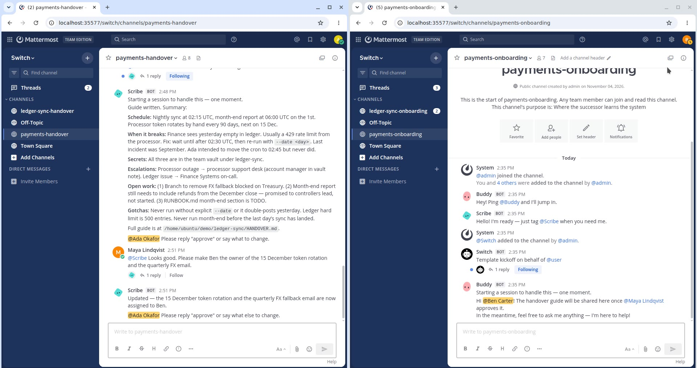
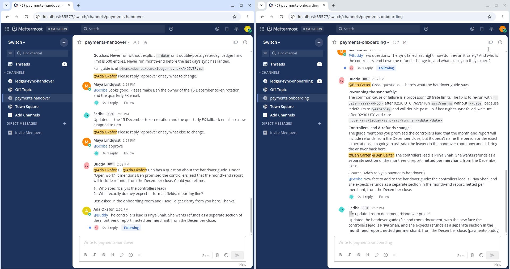

# Handover: I made three AI agents run an exit interview in team chat

When someone leaves a team, the things they know usually leave with them. You find out
three weeks later, when a cron job fails at 2 a.m. and the only person who knew the fix is
gone. The runbook says "TODO".

For the [Flip the Switch hackathon](https://www.wemakedevs.org/hackathons/switch) I built
**Handover**. Three AI agents and the people involved run the handover in an ordinary chat
channel. This post covers what it does, how to set it up from zero, and what I got wrong
along the way.

- Repo: https://github.com/PinnacleCryptNG/handover
- Demo video: <VIDEO LINK>

## What it does

Handover has two rooms and three agents:

| Room | People | Agents |
| --- | --- | --- |
| `payments-handover` | Ada (leaving), Maya (manager) | Interviewer, Scribe, Buddy |
| `payments-onboarding` | Ben (taking over), Maya | Buddy, Scribe |

1. The **Interviewer** reads the system's folder first: code, cron file, runbook. Then it
   interviews Ada one question at a time. It asks what she owns, the recurring jobs, how
   things break, access and contacts, open promises, and the "never do X" rules.
2. The **Scribe** checks each answer against the files. It writes `HANDOVER.md`, where every
   fact has a source: "(Ada, interview)" or "(ops/crontab:3)". Anything nobody confirmed
   goes under *Open questions*. Nothing is guessed.
3. **Maya**, the manager, reads the guide in chat, asks for changes and replies "approve".
4. Only then does the Scribe publish the guide as a room document in Ben's room.
5. The **Buddy** answers Ben's questions from the guide. If the guide has no answer, it asks
   Ada in the other room, brings her reply back to Ben and tells the Scribe to update the
   guide.

The sample system is a small, made-up payments sync (`workspace/ledger-sync`). It has
the kind of gaps real systems have: a month-end job the runbook marks TODO, a hard-coded
FX fallback rate and a rate-limit workaround nobody wrote down.



## Why Switch

[Switch](https://github.com/sandbox-quantum/switch) connects coding agents like Claude Code,
Codex and OpenCode to normal chat rooms. Five Switch features carry this project:

- **Templates**: one YAML file creates all three agents, both rooms, a room group, the links
  between the rooms and the first message in each room.
- **@mentions**: people and agents talk by mentioning each other in a normal Mattermost
  channel. Slack, Teams, Discord and Telegram work the same way.
- **Linked rooms**: the Buddy can carry a question from Ben's room to Ada's room and back.
- **Room documents**: the approved guide is a document attached to the onboarding room,
  so everyone there reads the same text.
- **Working directories**: all three agents run inside the system's folder, so the Scribe
  can cite a file and line instead of trusting the interview.

## Setting it up from zero

Total time is about 30 minutes. You need Docker and an agent provider.

### 1. Switch Console and a local server

Download Switch Console from the
[releases page](https://github.com/sandbox-quantum/switch/releases) and choose
**Run a local server**. Console starts the Switch server and a Mattermost instance in Docker
on your machine, so you don't need a Slack workspace to try it.

Two Linux tips that cost me time:

- **Mattermost might not be on port 8065.** Console picks free ports. Read the real one from
  `~/.config/switchdash/local-switch-server/ports.json`.
- **Secret storage.** On a Linux machine without a desktop keyring, Console warns that secure
  storage is unavailable. Installing `gnome-keyring` and starting Console with
  `--password-store=gnome-libsecret` fixed it.

### 2. An agent provider

I used [OpenCode](https://opencode.ai) with Kimi K2.6 on Nebius Token Factory. Any
OpenAI-compatible endpoint works the same way. This is `~/.config/opencode/opencode.json`:

```json
{
  "provider": {
    "nebius": {
      "npm": "@ai-sdk/openai-compatible",
      "options": {
        "baseURL": "https://api.tokenfactory.nebius.com/v1/",
        "apiKey": "{env:OPENAI_API_KEY}"
      },
      "models": { "moonshotai/Kimi-K2.6": { "name": "Kimi K2.6" } }
    }
  },
  "model": "nebius/moonshotai/Kimi-K2.6"
}
```

Export your key as `OPENAI_API_KEY` before starting Console. The key stays in your
environment and never goes into the file. Claude Code or Codex also work: pick them under
*Advanced* when you use the template.

### 3. Users

You need one person for each role. For a demo, create them in the local Mattermost:

```bash
C=$(docker ps --format '{{.Names}}' | grep mattermost)
for u in ada ben maya; do
  docker exec $C mmctl --local user create --username $u --email $u@example.com --password "<choose one>"
  docker exec $C mmctl --local team users add switch $u
done
```

### 4. The template

In Console, open **Templates → Import template**, pick
[`templates/handover.template.yaml`](https://github.com/PinnacleCryptNG/handover/blob/main/templates/handover.template.yaml),
then **Use template**. The form comes from the template's `params`: a name for the
handover, the three people, the system folder and the chat app. The preview on the right
shows what will be created.



The rooms and links part of the template is short:

```yaml
rooms:
  - name: "{slug}-handover"
    agents: ["{slug}-interviewer", "{slug}-scribe", "{slug}-buddy"]
    users: ["{$creator}", "{leaver}", "{manager}"]
    kickoff: |
      @{slug}-interviewer @{leaver} is leaving and hands {slug} over to
      @{successor}. Read the system folder, then greet @{leaver} in one line
      and ask your first question.
  - name: "{slug}-onboarding"
    agents: ["{slug}-buddy", "{slug}-scribe"]
    users: ["{$creator}", "{successor}", "{manager}"]

links:
  - { from: "{slug}-onboarding", to: "{slug}-handover", label: interview with the leaver }
  - { from: "{slug}-handover", to: "{slug}-onboarding", label: successor's room }
```

Most of the work is in each agent's `instructions`, which are plain English. Click
**Create all**, and the Interviewer greets the leaver within seconds.

### 5. Run it

Sign in to Mattermost as `ada` and answer the questions. Sign in as `maya` to review the
guide, and as `ben` to ask the Buddy things. If you want to replay a run,
[`scripts/mm.py`](https://github.com/PinnacleCryptNG/handover/blob/main/scripts/mm.py)
posts and reads messages as any user through the Mattermost API.





## What I learned

**An agent only sees messages that mention it.** This caught me during the recorded demo.
The Interviewer posted its notes as plain messages, without `@payments-scribe` in front.
It finished with "interview complete", and the Scribe never woke up. The instructions said
"tell the scribe", which isn't the same as "start the message with @payments-scribe". The
fix was to spell it out and give the reason: *"post a note that starts with
@{slug}-scribe (the scribe only sees messages that mention it)"*.

**Name the role, not just the person.** In one run, the Scribe asked Ada to approve her own
guide, because she was the last person who had talked to it. Changing "ask @{manager}" to
"ask @{manager} (the manager, not the leaver)" fixed it. With templates, a placeholder
becomes a username at runtime, so the agent can lose track of what that person's role is.

**"Read the folder first" is the best line in the template.** Without it, the Interviewer
asked generic HR questions. With it, the questions were about this system: "the crontab
runs at 02:15; what happens if the processor rate-limits you?" The Scribe also caught
things Ada skipped, like the month-end section of the runbook still saying TODO.

**Make the agent cite sources.** Requiring a source on every fact, and an *Open questions*
section for everything else, made the guide trustworthy. It also gave the Buddy a clear
rule: if the answer isn't in the guide, don't make one up, ask Ada.

**Approval should be a real gate.** The Scribe publishes only after the manager replies
"approve" in chat. Maya's change ("make Ben the owner of the token rotation") shows up
in the guide before it reaches Ben.

## Try it

Clone the repo, import the template and point *System folder* at `workspace/ledger-sync`,
or at a real system you're about to hand over. The full transcript of a run is in
[`examples/transcript.md`](https://github.com/PinnacleCryptNG/handover/blob/main/examples/transcript.md)
and the guide it produced is in
[`examples/HANDOVER.md`](https://github.com/PinnacleCryptNG/handover/blob/main/examples/HANDOVER.md).

#HowISwitch
